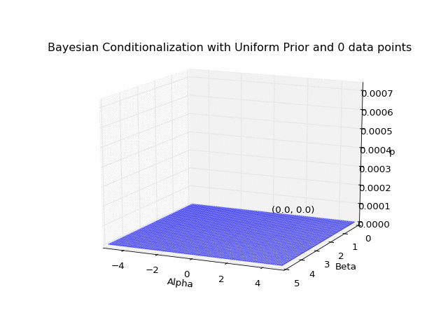
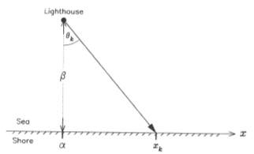
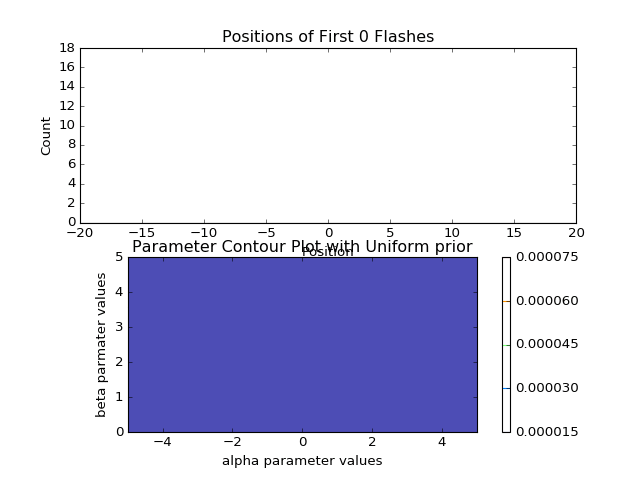

The lighthouse problem was a computational physics lab assignment that I decided to go above and beyond for. Below is a summary of the problem and my solution.

## The Problem

Here's a statement of the the problem, adapted from the Ph21 assignment:

>   
There is a deffective lighthouse located at a position α along the shore and a distance β out to sea (see figure above). The lighthouse emits highly collimated flashes at random times and at random azimuths (a good lighthouse emits flashes at regular intervals, usually due to rotation of the lighthouse beam). A dense array of photodetectors is set up along the shore and each flash is recorded by a single photodetector. The data consist of the position $$x_k$$ of the illuminated photodector for the $$k$$th flash.  
Consider the case where neither α nor β are known beforehand. Calculate the distributions of the logarithm of the posterior probability for a grid of α and β values. Then plot the 2-dimensional distribution of the posterior distribution as a contour plot in the α-β plane.

## Solution

As you might've guessed from the use of the word "posterior", the main idea is to use Bayesian statistics to infer the lighthouse's position based on a string of photodetector data. From Bayes' theorem:

$$  P(h \vert e) = \frac{P(e \vert h)P(h)}{P(e)} $$

where $$P(h \vert e)$$ is the **posterior** probability assigned to some hypothesis h based on some set of evidence e, $$P(h)$$ is the **prior** probability assigned to h (prior to observing e), and $$P(e \vert h)$$ is the **likelihood** of observing evidence e *given* that h is true. $$P(e)$$ just amounts to a normalization factor on the posterior distibution; I don't know of any cool name for it.

### A Prior(i)

As is typical of problems involving Bayesian conditionalization, the choice of prior is necessarily a bit arbitrary. I'll spare you the philosophy of probability schpiel, but suffice to say that it's difficult (and sometimes impossible) to construct a truly information-free prior. Since the context of this problem is presumably a nearby ship hoping to identify the location of the lighthouse, I decided it was reasonable to use a uniform probability distribution over a small rectangle in $$\alpha$$-$$\beta$$ space, with $$-5<=\alpha<=5$$ (in arbitrary distance units) and $$0<=\beta<=5$$ (with the lower bound set st the lighthouse is assumed not to be inland):

$$ \frac{\partial^2 P_{prior}(\alpha,\beta)}{\partial \alpha \partial \beta} = \begin{cases}
                                   \frac{1}{50} & \text{if $-5<=\alpha<=5$ and $0<=\beta<=5$} \\
                                   0 & \text{else}
  \end{cases}
$$

### The Likelihood

$$\int_0^{2\pi}T(O)dO$$

### Implementation

~~~ python
print "TODO" # It's Python 2, so this is acceptable syntax
~~~

