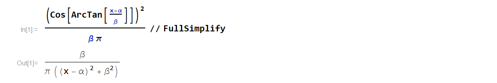
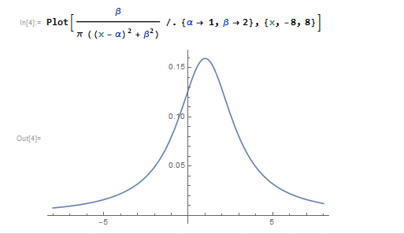

The lighthouse problem was a computational physics lab assignment that I decided to go above and beyond for. Below is a summary of the problem and my solution.

## The Problem

Here's a statement of the the problem, adapted from the Ph21 assignment:

>   
There is a defective lighthouse located at a position α along the shore and a distance β out to sea (see figure above). The lighthouse emits highly collimated flashes at random times and at random azimuths (a good lighthouse emits flashes at regular intervals, usually due to rotation of the lighthouse beam). A dense array of photodetectors is set up along the shore and each flash is recorded by a single photodetector. The data consist of the position $$x_k$$ of the illuminated photodector for the $$k$$th flash.  
Consider the case where neither α nor β are known beforehand. Calculate the distributions of the logarithm of the posterior probability for a grid of α and β values. Then plot the 2-dimensional distribution of the posterior distribution as a contour plot in the α-β plane.

## Solution

As you might've guessed from the use of the word "posterior", the main idea is to use Bayesian statistics to infer the lighthouse's position based on a string of photodetector data. From Bayes' theorem:

$$  P(h \vert e) = \frac{P(e \vert h)P(h)}{P(e)} $$

where $$P(h \vert e)$$ is the **posterior** probability assigned to some hypothesis h based on some set of evidence e, $$P(h)$$ is the **prior** probability assigned to h (prior to observing e), and $$P(e \vert h)$$ is the **likelihood** of observing evidence e *given* that h is true. $$P(e)$$ just amounts to a normalization factor on the posterior distribution; I don't know of any cool name for it.

### A Prior

As is typical of problems involving Bayesian conditionalization, the choice of prior is necessarily a bit arbitrary. I'll spare you the philosophy of probability spiel, but suffice to say that it's difficult (and sometimes impossible) to construct a truly information-free prior. Since the context of this problem is presumably a nearby ship hoping to identify the location of the lighthouse, I decided it was reasonable to use a uniform probability distribution over a small rectangle in $$\alpha$$-$$\beta$$ space, with $$-5\leq\alpha\leq5$$ (in arbitrary distance units) and $$0\leq\beta\leq5$$ (with the lower bound set st the lighthouse is assumed not to be inland):

$$ \frac{\partial^2 P_{prior}(\alpha,\beta)}{\partial \alpha \partial \beta} = \begin{cases}
                                   \frac{1}{50} & \text{if $-5\leq\alpha\leq5$ and $0\leq\beta\leq5$} \\
                                   0 & \text{else}
  \end{cases}
$$

### The Likelihood

Now we need to determine the form of the likelihood, $$P(x_k \vert \alpha, \beta)$$, so it's time for some math. We're told that "the lighthouse emits highly collimated flashes at random times and at random azimuths," so we know that the emissions are uniformly distributed in $$\theta$$: $$\frac{\partial P(\theta_k \vert \alpha, \beta)}{\partial \theta} = \frac{1}{\pi}$$ (only angles $$-\pi/2<\theta_k<\pi/2$$ will actually reach a detector along the shore). Now... (refer to the figure),

$$ \tan(\theta) = \frac{x - \alpha}{\beta}$$, so $$\theta = \arctan(\frac{x - \alpha}{\beta})$$, or equivalently $$ x = \beta \tan(\theta)+\alpha \rightarrow \frac{dx}{d\theta} = \beta \sec^2(\theta)$$

Treating $$\alpha$$ and $$\beta$$ as given, we can find the probability of observing a flash at a given -range by equating it to the probability of a flash being emmitted in the corresponding angle range

$$P(x_1 \leq x \leq x_2) =  \int_{x_1}^{x_2}\frac{\partial P}{\partial x}dx =  \int_{\theta(x_1)}^{\theta(x_2)}\frac{\partial P}{\partial x} \frac{dx}{d\theta} d\theta = \int_{\theta(x_1)}^{\theta(x_2)}\frac{\partial P}{\partial x} \beta \sec^2(\theta) d\theta =
\int_{\theta(x_1)}^{\theta(x_2)}\frac{\partial P}{\partial \theta} d\theta $$

Since the integrals are equivalent regardless of $$x_1$$ and $$x_2$$, we can simply equate the integrands:

$$\frac{\partial P}{\partial x} \beta \sec^2(\theta(x)) = \frac{\partial P}{\partial \theta} = \frac{1}{\pi}$$

$$\Rightarrow \frac{\partial P}{\partial x} = \frac{\cos^2(\theta(x))}{\beta \pi} = \frac{\cos^2(\arctan(\frac{x-\alpha}{\beta}))}{\beta \pi}$$

and we arrive at the rather convoluted likelihood function: $$P(x \vert \alpha, \beta) = \frac{\cos^2(\arctan(\frac{x-\alpha}{\beta}))}{\beta \pi}$$

Fortunately, there is another useful tool our kit. One of the best friends of many physicists (or at least one of my best friends...) is Mathematica:

This simplified expression is immediately recognizable by mathematicians as a Cauchy distribution, and by physicists as a Lorentzian. Whatever you want to call it, the distribution pops up all over the place and this is a good sign that we're on the right track.

### Posterior

Putting together what we've established thus far, we have a complete prescription for how to construct a posterior pdf over the lighthouse's positional parameters, based off a photedetector measurement $$x_1$$:

$$\frac{\partial^2 P_{posterior}(\alpha,\beta\vert x_1)}{\partial \alpha  \partial \beta} = \frac{\partial^2 P_{prior}(\alpha,\beta)}{\partial \alpha  \partial \beta} \frac{P(x_1 \vert \alpha, \beta)}{C} = \frac{\beta}{\pi((x_1-\alpha)^2 + \beta^2)} \begin{cases} 
                                    \frac{1}{C} & \text{$-5\leq\alpha\leq5$ & $0\leq\beta\leq5$} \\
                                   0 & \text{else} \end{cases}$$

where C is the normalization constant st $$\int_{0}^{5} \int_{-5}^{5} \frac{\partial^2 P_{posterior}(\alpha,\beta\vert x_1)}{\partial \alpha \partial \beta} d\alpha d\beta = 1$$

If we wanted, we could treat our posterior distribution after the first data point as an updated prior on which to conditionalize the second data point, and so on. But this is equivalent to conditionalizing on the total data set $$x_k$$ all at once:

$$Pdf_{posterior}(\alpha,\beta\vert x_k) =  \displaystyle \prod_{j=1}^{k} \frac{\beta}{\pi((x_j-\alpha)^2 + \beta^2)}  \begin{cases} 
                                   \frac{1}{C} & \text{$-5\leq\alpha\leq5$ & $0\leq\beta\leq5$} \\
                                   0 & \text{else} \end{cases}$$

### Implementation

First, I defined a set of true lighthouse parameter values, as well as a total number of flashes to generate:

~~~ python
"""Pertinent parameter values"""
a = float(1) #true lighthouse alpha parameter
b = float(2) #true lighthouse beta parameter
j = 8 #I'll generate 2^j data points

"""Generating data to conditionalize on"""
thetaD = np.random.uniform(-np.pi/2, np.pi/2, 2**j) #theta data, drawn from uniform distribution between -pi/2 and pi/2
xD = b*np.tan(thetaD) + a #position data from photodetectors
~~~

Next, I discretized the $$\alpha-\beta$$ plane into a 2-D grid of $$(\alpha,\beta)$$ tuples to consider.

~~~ python
parmsA = np.linspace(-5, 5, num = 1001)#alpha parameter vals
parmsB = np.linspace(0, 5, num = 501)#beta parameter vals
aa, bb = parms = np.meshgrid(parmsA, parmsB)
~~~

For a single $$(\alpha,\beta)$$ pair, updating the probability based on a photodetector datapoint is accomplished exactly as we derived in the previous section:

~~~ python
def Prob(alp, beta, x, priorAB):
	pro = priorAB
	lh = beta/(np.pi * ((x-alp)**2 + beta**2))
	pro = pro*lh
	return pro
~~~

where lh is the Lorentzian likelihood function specific to that particular $$(\alpha,\beta)$$ pair.

Now, we want to iteratively update each $$(\alpha,\beta)$$ tuple in the meshgrid after each additional photedector recording. This step is admittedly a bit gross...

~~~python
def Conditioner(data, j, aparms, bparms, priorA, priorB, arg1=None,arg2=None, arg3=None,arg4=None):
#Same as Conditioner, but uses log likelihood, as recommended by the hint.
	priAlpha = priorA(aparms, arg1, arg2)
	priBeta  = priorB(bparms, arg3, arg4)
	OB = np.multiply(priAlpha, priBeta)
	OB = OB/float(np.sum(OB)) #Distribution prior to data, normalized
	posts = OB
	distrbs = OB[...,np.newaxis] #this will store my distribution for each subset of data
	m = np.amax(OB)
	stats = np.array([0.0, 0.0, OB[0,0]])
	print("l = 0, Stats = ", stats)
	allStats = stats
	for i in range(0, 2**j):
		d = data[i] #treat previous probH as prior, and then parameterize ith data point.
		assert(aparms.shape == bparms.shape == posts.shape)
		posts = Prob(aparms, bparms, d, posts)
		posts = posts/np.sum(posts) #normalizing
		stats = WeightedStats(aparms, bparms, posts)
		if i+1 in np.exp2(np.arange(j)):
			print("l = ", i+1, ", Stats: = ", stats)
		distrbs = np.concatenate((distrbs, posts[...,np.newaxis]), axis = -1)
		allStats = np.vstack((allStats, stats))
		if m < np.amax(posts): 
			m = np.amax(posts)		
	return (distrbs, allStats, m) #returns a tuple with all that stuff...
~~~

Note that if all I had cared about was identifying the most likely $$(\alpha,\beta)$$ pair after considering _all_ $$2^j$$ data points, it would be more efficient to simply compute the sum (at each grid coordinate) of the log likelihoods over the total data set, and identify the tuple with the largest sum. I instead elected to write the more pained function above, because I had wanted to animate the Bayesian updating of the posterior distribution after each additional data point (see animations at top and bottom of page). Additionally, instead of estimating the optimal (largest posterior) $$(\alpha,\beta)$$ pair with this brute-force grid sampling, we could survey the parameter space more intelligently by using Markov chain Monte Carlo sampling methods (and indeed this was the focus of the next Ph21 assignment), but that's a topic for another time.

If you'd like to play with the code yourself, it can be found here:[Lighthouse.py](ComputationalPhysicsLab/LighthouseProblem/Lighthouse.py) (Python 2).
