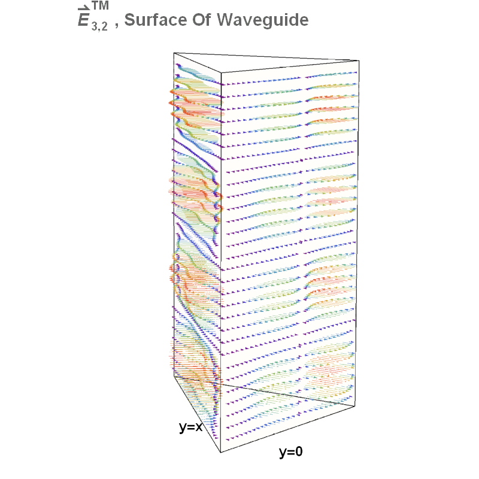
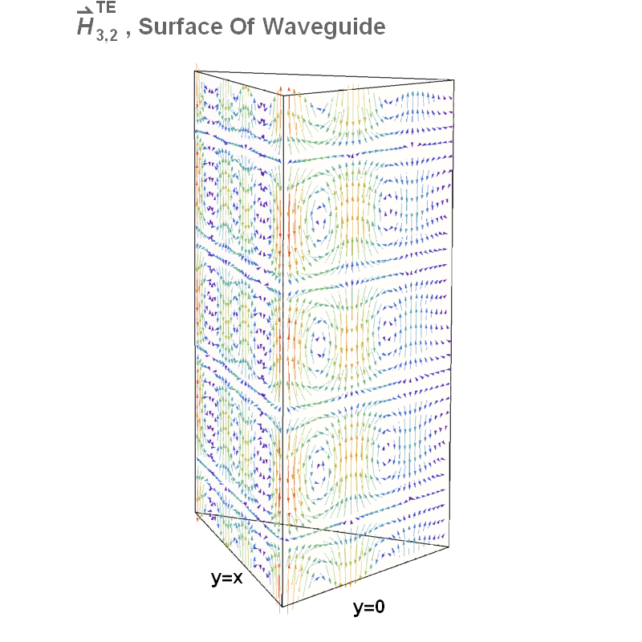

## Waveguide Animations

Here are some waveguide animations I generated with Mathematica. The animations show the temporal and spatial dependencies of either the electric ($$\vec{E}$$) or magnetic ($$\vec{H}$$) fields for different TE and TM modes propagating through rectangular/right-triangular hollow waveguides.
Unlike the plain plane-wave solutions typical of the EM wave equations in free space, the boundary conditions of hollow waveguides don't allow for TEM modes. Instead a generic field propagation through a hollow waveguide can be decomposed into two types of modes: Transverse Electric (TE) and Transverse Magnetic (TM). In a TE mode the E-field is entirely transverse (perpendicular to the direction of propagation), but the H-Field will have a longitudinal component, and vice-versa for a TM mode.

All these animations, and several others, are available for view/download from my [github repository](https://github.com/alexjbrinson/alexjbrinson.github.io/tree/master/WaveGuideAnimations)

### Right-Triangular Waveguide Modes

Transverse Magnetic (TM) | Transverse Electric (TE)
------------ | -------------
 | 
 | 

___

## Waveguide Notebooks
 This is the Mathematica notebook I wrote to generate rectangular waveguide animations: [AnimationsRectangular.nb](WaveGuideAnimations/AnimationsRectangular.nb). I am not including any code particular to the right-triangular geometry, as the determination of the modal solutions is the subject of a homework problem in Ph 106c (EM course at Caltech).

