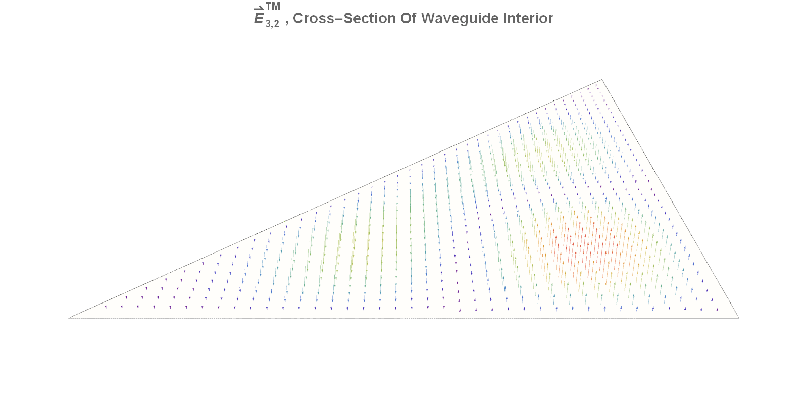
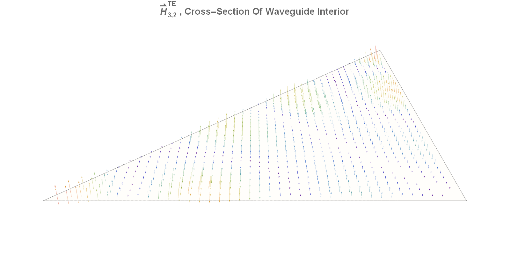
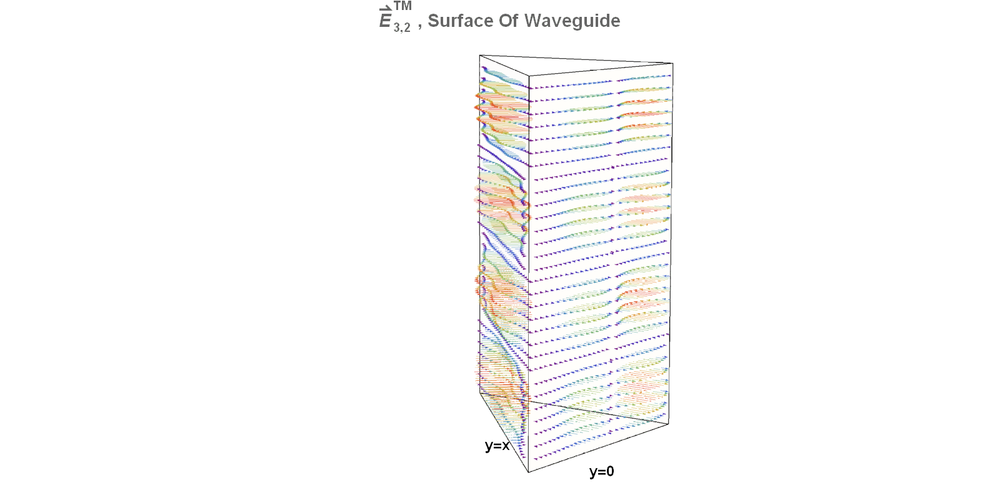
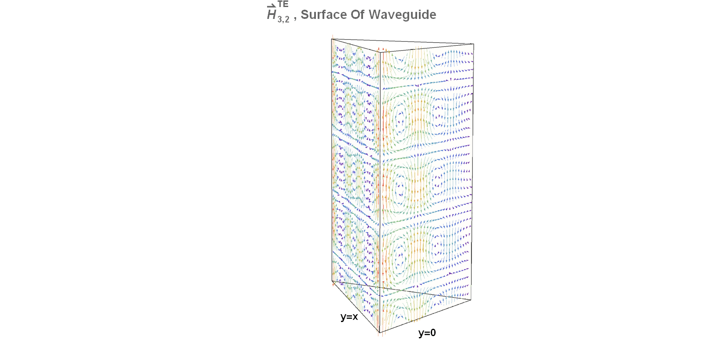
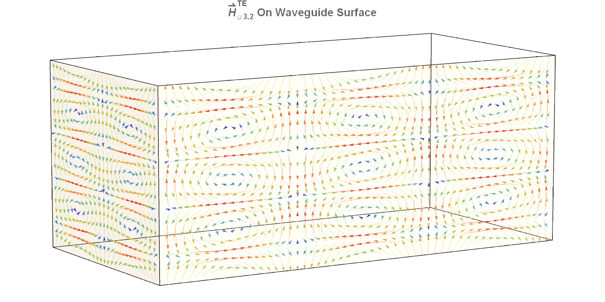

# Alex Brinson

[Home][1]
[Waveguides][2]
[nBody Simulator][3]
[Light House Problem][4]
[nEDM][5]

---

## Waveguide Animations

Here are some waveguide animations I generated with in Mathematica. The animations show the temporal and spatial dependencies of either the electric (E) or magnetic (H) fields for different TE and TM modes propagating through rectangular/right-triangular hollow waveguides.
Unlike the plain plane-wave solutions typical of the EM wave equations in free space, the boundary conditions of hollow waveguides don't allow for TEM modes. Instead a generic field propagation through a hollow waveguide can be decomposed into two types of modes: Transverse Electric (TE) and Transverse Magnetic (TM). In a TE mode the E-field is entirely transverse (perpendicular to the direction of propagation), but the H-Field will have a longitudinal component, and vice-versa for a TM mode.

### Right-Triangular Waveguide Modes

Transverse Magnetic (TM) | Transverse Electric (TE)
------------ | -------------
 | 
 | 

### Rectangular Waveguide Modes

___

## Waveguide Notebooks
 These are the Mathematica notebooks I wrote to generate the above animations:

* AnimationsTriangular.nb goes here
* AnimationsRectangular.nb goes here

I originally created the triangular waveguide notebook because I had just finished a Ph 106c problem where I needed to determine the possible modes of propagation for a right-triangular hollow waveguide, and I was curious to see what my solutions actually looked like. After that I decided I might as well repeat the procedure for a rectangular geometry, and my professor (Sunil Golwala) actually liked the results enough to ask if he could post them next year when he covered the topic!

[1]:https://alexjbrinson.github.io/
[2]:https://alexjbrinson.github.io/Waveguides
[3]:https://alexjbrinson.github.io/nBodySim
[4]:https://alexjbrinson.github.io/LightHouse
[5]:https://alexjbrinson.github.io/nEDM
