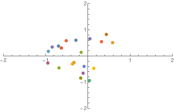
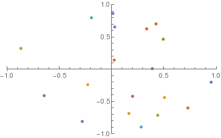
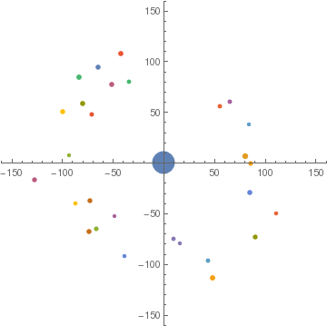

# Alex Brinson

[Home][1]|
[Waveguides][2]|
[nBody Simulator][3]|
[Light House Problem][4]|
[nEDM][5]

---

## Animations from nBody Simulations

A couple years ago I wrote some Python code for the computational physics course Ph 22, where I simulated 1/r^2 interactions between n objects using 4th-order Runge-Kutta numerical integration. I didn't know how to animate with Python back then, so I imported all of the simulation data as csv files into Mathematica, and stitched the gifs together there. Here's one of the results:

After completing the assigned task I decided to add a really simplistic "collision" mechanism, whereby objects would merge (conserving momentum, of course) if their centers were separated by less than the sum of their radii. Here are a couple of animations where the masses were allowed to merge:

[1]:https://alexjbrinson.github.io/
[2]:https://alexjbrinson.github.io/Waveguides
[3]:https://alexjbrinson.github.io/nBodySim
[4]:https://alexjbrinson.github.io/LightHouse
[5]:https://alexjbrinson.github.io/nEDM
